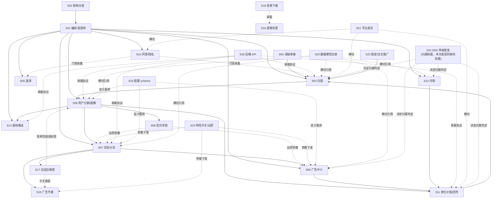

# 槽位对齐研究：两次「领域拆解」实践的事实盘点

本文只陈述事实与判断依据，不提设计方案。所有结论标注来源文件与位置（行号或章节号），可逐条核查。
文中「读出来的事实」不加标记；凡我的推断一律以 `[推断]` 开头并给出判据与置信度。

## 0 语料与基线

| 语料 | 路径 | 规模 | 性质 |
|---|---|---|---|
| Vita Mahjong 竞品 SDK 拆解规格 | `/Users/zengjie/workspace/playground/vita-majhong-re/docs/sdk-teardown/` | 22 文件 / 11,489 行 | 对 Meevii/Learnings `UniKit` 的逆向重建规格 |
| Vita Mahjong 自研 SDK 设计 | `/Users/zengjie/workspace/playground/vita-majhong-re/docs/sdk-design/` | 23 文件 / 14,899 行 | 对标产出的 normative 设计规格 |
| Vita Mahjong RE 原始笔记 | `/Users/zengjie/workspace/playground/vita-majhong-re/notes/` | 20 篇（arch/core/elem/rule 四类） | 拆解规格的上游证据 |
| Gossip Harbor SDK 系列笔记 | `/Users/zengjie/workspace/playground/2026-06-09-gossip-harbor-re/notes/arch-09..12` | 4 文件 / 610 行 | 对 Microfun `OneSDK` 的逆向 + 与设计规格的对比 |

一个必须先说清的关系事实：`vita-majhong-re/docs/sdk-design/` 与 `2026-07-10-growth-sdk/docs/specs/` 是**同一份设计规格的两个副本**。
`diff -rq` 显示两目录 23 个同名文件全部存在（内容有版本漂移），growth-sdk 侧另有 6 个新增篇（`23-offer-promotion`、`24-monetization-orchestration`、`25-reward-economy`、`26-house-ads-cross-promotion`、`32-economy-pacing-policy`、`44-experiment-analysis`）。
而 `arch-11-onesdk-vs-growthsdk-spec.md` 第 3 行明写其基准是「`2026-07-10-growth-sdk/docs/specs/`，23 篇 normative 契约」。

**这意味着两次实践并非独立平行，而是串行的**：Vita 拆解 → Vita 设计规格 → 该规格被搬到 growth-sdk → Gossip 以它为槽位模板做对比。
Gossip 的 arch-11 事实上已经是一次「按槽位填、跨游戏对比」的手工实现（`arch-11:29-52` 的「判定汇总矩阵(23 篇速览)」）。本文的对齐度量在很大程度上是在复核并扩展这张已有矩阵。

## 1 槽位清单

### 1.1 槽位的两级结构（这是读出来的，不是我归纳的）

Vita 拆解侧的 15 个模块篇（`10`–`24`）**逐字使用同一套六段模板**，无一例外：

```
## 1 职责与范围
## 2 API 契约
## 3 数据模型
## 4 关键机制/算法
## 5 桥接与回调 + 后端协议
## 6 平台差异（iOS / Android）
## Data Sources
```

（核验命令：`grep "^## " 1*.md 2*.md`，15 个模块篇的 H2 序列完全同构，只在 H2 标题后缀有措辞差异，例如 `23-download.md` 是「## 3 数据模型与配置」。）

设计侧 14 个模块篇 + 2 个消费侧篇沿用同一模板，只把「2 API 契约」改称「2 公开接口（重设计）」、「5 桥接与回调 + 后端协议」改称「5 桥接 / 回调 / 后端协议」。两处例外：`16-conversion-value.md` 插入了一节「5 完整规则汇总」使后续编号后移；`19-notification.md` 插入了「7 集成示例：本地通知留存策略（消费侧）」。

所以**槽位天然是两级的**：领域槽位（一个子系统）× 6 个固定切面槽位。下面 §1.2 是领域槽位，§1.3 是切面槽位。

### 1.2 领域槽位（用问题表述）

| ID | 槽位问题 | Vita 拆解填充位置 | Gossip 填充位置 |
|---|---|---|---|
| S01 | 谁是 SDK 的唯一入口？模块按什么顺序装配，装配序有无不变量？ | `10-unikit-orchestration.md §4.1/§4.2`（7 模块固定顺序表，RVA 0x1F4DA18） | `arch-09:11`（`SDKManager` 是事件泵不是编排器）；`arch-11:58`（明确「无统一编排器、无装配序不变量」） |
| S02 | 托管/桥接/原生怎么分层？原生工作线程的回调怎么回到主线程？ | `01-architecture.md §4.1`（三层协作 + Mermaid 依赖图） | `arch-09:11`（`ConcurrentQueue` + `Update()` 逐帧抽干）；`arch-11:58` 判定「对齐度最高」 |
| S03 | 安装来源从哪采集？归一成什么数据结构？谁消费它？ | `11-attribution.md §3.1/§4.1/§4.2`（`AfData` + LXAppsFlyer 五机制 + Install Referrer 自采） | `arch-09 §3.2`（AppsFlyer 原始 JSON 按键读，归因三件套织入 5 处报文）；`arch-10 §五` |
| S04 | 点击深链与延迟深链走哪条通道？客户端读不读字面 campaign？ | `11-attribution.md §4.3 EDDL` / `§4.4 UDL` | `arch-12 §二/§三`（层 A 服务器裁决；层 B 只有 `invite_friends` / `facebook_link_rewards` 两个自有 campaign 走字面路由，其它 `Clear()` 丢弃） |
| S05 | 埋点事件怎么构建？走几条物理管线？有没有采样白名单？ | `11-attribution.md §3.6 事务式埋点容器` / `§3.7 AnalyticsControlInfo` / `§4.6`（**无独立章，内嵌在归因篇**） | `arch-09 §3.6`（自研 dot BI ~1000 事件码 ‖ 外部归因双管线）；`arch-11:66` 记「GH 无采样白名单」 |
| S06 | 用户标签由谁算（端上还是云上）？输入维度有哪些？数值怎么分桶？ | `12-usertag.md §3.2`（`InnerTagData` 约 30 getter）/ `§4.6 GetTagConfigValue` / `§4.7 A 层七类枚举映射表` | `arch-09 §3.3`（客户端只上交 `lel/plel/region/pay/lost_days`，服务器分群） |
| S07 | 分组身份从哪来？分桶算法是什么？曝光怎么计数？ | `13-abtest.md §4.1 GetAbTestIndex`（MD5 确定性分桶，T1 逐指令还原）/ `§4.2 GroupId 生命周期` / `§4.8 染色` | `arch-09 §3.3`：`group_name`/`valid_group_name` 登录下发，**零客户端实验框架**（全树 grep `GetExperiment`/`GetAbGroup`/`AssignmentId`/`ComputeBucket` = 0） |
| S08 | 定向规则在哪求值？支持哪些维度和算子？ | `14-abcenter.md §3.1 BoundaryModel` / `§4.2 boundaryMatches 数据驱动分发` / `§4.3 三种匹配语义` | `arch-11:70`（唯一沾边的是订单过滤器 `RandomOrderHelper.GetSelectedFilterConfig` 三维闭区间，`MainOrderCreatorRandom.lua:298-317`） |
| S09 | 谁做瀑布/竞价？支持哪些广告形态？成交数据长什么样？ | `15-ad-mediation.md §4.1 三聚合` / `§4.2 InHouse 瀑布 + 头竞价（二价拍卖）` / `§3.3 ad_config.json 完整 schema` | `arch-10 §4.1/§4.2`（原生 AppLovin MAX 撮合 7 家网络；托管层只暴露 `LoadRewardedAd/IsRewardedAdReady/ShowRewardedAd`） |
| S10 | 广告展示的冷却与频控由谁决定？是否随玩家实时状态自适应？ | `16-ad-monetization-strategy.md §4.3 GetInterCooldown` / `§4.4 ApplyToleranceCd`（卡关容差调节，T1）/ `§4.7 重开保护` | `arch-09 §3.5`（`CanShowAd` 本地闸门链：渠道/就绪/等级/日次数/冷却/价值门槛，参数全来自服务器 `adAllControl`）；`arch-11:74` 判定「静态服务器配置驱动的一次性放行，非状态化策略引擎」 |
| S11 | 哪些事件回传给投放平台？SKAd conversion value 由谁装桶？ | `17-growth-grt-skad.md §4.1 EventRuleManager` / `§4.3 AdvancedTaiChi multiplier`（T1）/ `§4.6 6-bit fine + coarse CV` | `arch-09 §3.7`（回传事件表 11 行 + oper `adjust` 配置大脑）；`arch-10 §4.3`（广告收入**零回传**，调用图级坐实）；`arch-10 §8.2`（客户端零 CV 装桶，全交 AppsFlyer） |
| S12 | 下单→验单→发货怎么走？验单真相源在哪？去重与掉单怎么处理？ | `18-purchase.md §4.2 购买时序` / `§4.4 本地订单去重` / `§4.5 挂起订单恢复` | `arch-09 §3.5`（自研 `ACProofAndGetStatus` 验单主路径）；`arch-10 §3.1`（`MFBillingClient` 内无 PurchaseConnector，grep 零命中） |
| S13 | 本地通知的数据模型多富？权限请求策略是什么？触达回执怎么回收？ | `20-push.md §3.1 NotificationData` / `§4.2 权限请求状态机` / `§5.2 触达回执时序` | **仅 `arch-11:43` 矩阵一行**：`ScheduleNotifi(5 标量)` 极简 + 卸载归因 |
| S14 | 隐私政策 / CMP / ATT 三门怎么串？采集是否被同意前置门控？ | `21-privacy-att.md §4.1 三门同意状态机` / `§4.3 AttDlgLogicConfig 远控决策`（T1 值编码） | `arch-09 §3.5`（Google UMP + `adPrivacyOpen`）；`arch-10 §3.4`（ASAA = 网页化家长同意，非归因）；`arch-11:90`（四条独立流程、无统一 `ConsentState`） |
| S15 | 远程配置怎么下发与增量？能不能远程改逻辑？ | `22-remote-control.md §4.1 前台热启动特性开关判定`（Tier1）/ `§4.4 与配置下发的关系`（Tier3） | `arch-11:94`（`ConfigModel` ~44 `ServerConfigKey` + per-key md5 diff + `fileReplace` + Addressables 下发新 Lua） |
| S16 | 下载状态机、完整性校验、重试与并发怎么做？ | `23-download.md §4.4 FileDownloader 11 态状态机` / `§4.6 CRC32 校验` / `§4.3 并发调度` | **仅 `arch-11:94` 一句**：「把可靠下载交给 Unity Addressables 引擎，spec 那套 12 态下载器状态机在 GH 托管层不可见」 |
| S17 | 难度按什么信号自适应？用什么评分模型？ | `24-dynamic-difficulty-glicko.md §4.1 三个核心公式` / `§4.3 动态目标胜率` / `§4.4 压力累加器`（均 ISIL T1） | `arch-11:98`：**明确的否定性结论**——全树 grep 无 `Glicko`/`Elo`/`rating`/`winRate`/`targetWinRate`/`dda`/受挫/压力信号 |
| S18 | 有哪些自研后端端点？鉴权、签名、加密怎么做？ | `30-backend-api-catalog.md §1 端点全表` / `§2 鉴权与凭据模型` / `§5 RSA-OAEP 加密` | `arch-11:102`（op 前缀路由 BL/SO/AC/DA + 二进制 octet-stream + md5 键增量 + 独立 oper 运营服；无信封加密，签名在原生 `CSNetLibManager` 黑盒） |
| S19 | 服务端下发的配置文件有哪些键、什么结构？ | `31-config-schemas.md`（680 行，`abtest_config.json` 8 顶层键 + `ad_config.json` 7 段 + `TagConfig.json`，含实测载荷） | **无**。`arch-12 §六` 明写「组→配置映射不在包里，须运行期取证」 |
| S20 | 跨模块枚举与常量的取值域是什么？ | `32-data-model-reference.md`（227 表行，枚举总表 + 常量键总表 + UserTag 取值域总表） | **无汇总篇**；等价内容散在正文（`AttrEventEnum` 18 值、`EBIType` ~1000、`ESsoSocialType` 18、`EAdType` 6） |
| S21 | iOS/Android（及渠道变体）哪些能力对等、哪些独有？ | `33-platform-differences.md §10 平台对等能力总矩阵` | `arch-10 §八`（iOS IPA 交叉验证，8.5 有净结论矩阵）；`arch-11:102`（编译期变体：海外/国内/小游戏三套） |
| S22 | 包里到底装了哪些第三方 SDK？托管层实际驱动了哪几个？ | **无独立普查章**。仅 `00-index.md` 勘误段做了三条事后边界澄清 | `arch-10 §二`（DEX 类前缀普查表，6 领域，含「托管层是否驱动」列） |
| S23 | 有没有裂变/邀请/交叉推广？出站链怎么构造，入站怎么归因？ | **无**。全 22 文件 grep `裂变`/`邀请`/`交叉推广`/`CrossPromotion` = 0 命中 | `arch-09 §四`（OneLink `GenInviteUrl` + 阶梯奖）、`§3.1`（`CrossPromotionModel` 导流自家游戏）、`arch-10 §8.4`（iOS `LSApplicationQueriesSchemes` 白名单佐证） |
| S24 | 能不能远程下发新的玩法逻辑（而不只是参数）？ | **无** | `arch-11:94`（Addressables `catalogue/catalogue_md5/force_download` → 整包替换 + `RestartGame`；且 `util.hotfix` 全树零调用） |

### 1.3 切面槽位（每个领域槽位内部的 6 个固定问题）

| ID | 切面槽位问题 | Vita 拆解 | Gossip |
|---|---|---|---|
| A1 | 这个子系统负责什么、不负责什么（边界）？ | 15/15 篇有 | 有，但形态是「关键文件表」+ 散文（`arch-09 §二`） |
| A2 | 游戏侧调用的公开 API 长什么样（签名级）？ | 15/15 篇有，逐方法签名 | 部分。只在 C# 桥接口处给到签名（如 `IAdClientBridge` 三方法） |
| A3 | 有哪些数据模型/字段/枚举，取值域是什么？ | 15/15 篇有，字段表 | 部分。枚举有（`AttrEventEnum` 18 值、`EAdType` 6 值），字段表少 |
| A4 | 核心算法/公式/状态机是什么，能否照此实现？ | 15/15 篇有，且多带伪代码或反汇编还原 | 罕见。仅 `CanShowAd` 闸门链、订单三维过滤器两处到达「可实现」粒度 |
| A5 | 托管↔原生怎么桥接？回调名是什么？后端端点与协议是什么？ | 15/15 篇有（`## 5`），含回调名汇总表 | 有端点与协议要点，无回调名汇总（`arch-09 §3.6` 给了 BI 端点/格式/flush 策略） |
| A6 | iOS 与 Android 的差异在哪？ | 15/15 篇有（`## 6`） | 集中在 `arch-10 §八` 一处，不逐模块拆 |

一个直接可读的事实：**Vita 侧 6 个切面槽位在 15 个模块上是 90/90 全填；Gossip 侧只有 A1/A5 稳定填充，A4 几乎全空**。这不是 Gossip 作者的疏忽，而是证据形态决定的——见 §6。

## 2 对齐度量化

### 2.1 核心数字

24 个领域槽位中：

| 类别 | 数量 | 占比 | 槽位 |
|---|---|---|---|
| 两侧都实质填充 | 16 | 67% | S01–S12、S14、S15、S18、S21 |
| 仅 Vita 填充 | 5 | 21% | S13、S16、S17、S19、S20 |
| 仅 Gossip 填充 | 3 | 12% | S22、S23、S24 |

144 个「领域 × 切面」子槽位（24 × 6）中，Vita 侧填了约 132（22 篇 × 6，扣 S22/S23/S24 的 18 格），Gossip 侧按 §1.3 的口径约填 60–70 格。**子槽位层面的双边覆盖率远低于领域层面的 67%**。

对照事实：`arch-11:29-52` 自己给出的 18 行矩阵判定分布是——`对齐`/局部对齐 集中在架构（02）与机制层；`GH 缺失` 集中在 12/13/14/16/30/31 六篇；`GH 更强` 集中在 18/21/22/20/11/40。本文的 S13/S16/S17/S19/S20 五个单边槽位中，S17 与 arch-11 的「GH 缺失」判定一致，其余四个 arch-11 未单列或判为「实现不同」。

### 2.2 单边槽位的逐个归因判断

关键区分：**「另一个游戏确实没有这个系统」是真实差异，「只是没去看」是方法论漏洞**。本次分析还发现第三类：**「系统存在但证据不可及」**。三类的判据不同。

| 槽位 | 判定 | 判据 | 置信度 |
|---|---|---|---|
| S17 自适应难度（仅 Vita） | **真实差异，已验证** | `arch-11:98` 记录了否定性搜索的**具体关键词表**：`Glicko`/`Elo`/`rating`/`winRate`/`targetWinRate`/`dda`/受挫/压力信号，并给出替代物的正面证据（`diffScore` 是静态物件权重之和、`TotalDiffScore` 是每日清零吞吐桶，非技能评分）。「搜了什么 + 找到了什么替代物」两条同时具备，是否定性证据的完整形态 | 高 |
| S24 逻辑热更（仅 Gossip） | **真实差异** | 技术栈本身构成判据：Gossip 是 Unity + xLua 双层（`arch-09:3`），脚本层可整包替换；Vita 是纯 IL2CPP C#，无脚本层。另 `arch-11:94` 记了 `util.hotfix` 全树零调用这一负向核验。`[推断]` 部分：Vita 侧无人做过「有没有热更」这个搜索，故严格说是「Vita 技术上不具备该形态」而非「已验证不存在」 | 高（技术前提）/ 中（未验证） |
| S13 通知推送（仅 Vita） | **方法论漏洞：系统存在但没去看** | 正面反证：`arch-10 §二` 的 DEX 普查表明确列出 `com.google.firebase`（含 `messaging`）在场且「托管层是否驱动 = 是」。系统客观存在。但 arch-09/10/12 三篇主查笔记全文无「通知」「推送」章节，唯一一处填充是 `arch-11:43` 的对比矩阵一行——即这个槽位**只因为 spec 逼问才被回答，且答案是一句判定而非一套机制** | 高 |
| S16 资源下载（仅 Vita） | **混合：部分真实差异 + 部分没去看** | 真实差异部分：`arch-11:94` 明写 GH「把可靠下载交给 Unity Addressables 引擎」——自研 12 态下载器确实不存在，被引擎替代，这是真实的架构选择差异。没去看部分：Addressables 的 `catalogue/catalogue_md5/force_download` 下发链条只在 arch-11 一句带过，`AddressableManager.cs:885,1035` 在 arch-09:183 被引用但从未展开 | 中 |
| S19 配置 schema（仅 Vita） | **第三类：证据不可及（取证手段不匹配）** | `arch-12 §六` 与 `arch-09 §七` 都明写：「哪个 campaign 进哪个组、哪个组拿哪份 config payload，由服务器决定，静态代码看不到」「要坐实需用 arch-08 的运行期取证管线」。Vita 侧能填这个槽位是因为 `abtest_config.json`/`ad_config.json`/`TagConfig.json` **是打进包里的本地文件**（`31-config-schemas.md` 标「实测载荷 T0」）；Gossip 的等价物在服务器。既非「没这个系统」也非「没去看」 | 高 |
| S20 数据模型总表（仅 Vita） | **形态差异，非覆盖差异** | Gossip 侧等价内容存在且分散：`AttrEventEnum` 18 值（`arch-09:105`）、`EBIType` ~1000 码、`ESsoSocialType` 18 值、`EAdType` 6 值、~44 `ServerConfigKey`/~70 `EGeneralConfType`/~99 `ActivityType`（`arch-11:94`）。缺的是「汇总成附录」这个动作，不是数据本身 | 高 |
| S22 SDK 阵容普查（仅 Gossip） | **方法论漏洞：Vita 没去看，且已造成实际返工** | 最强的一条判据：Vita `00-index.md` 的「统一勘误」段共 5 条，其中 3 条全是**归属误判的事后修正**——「`/api/v1/app_sdk/config` 实为 TikTok Business SDK，非 Learnings 自研」「SKAd 相关 `skadsdk`/`gcdsdk` 与 `validate-and-log` 为 AppsFlyer SDK 内建」「内购无 Learnings 自研验单后端」。这三条正是缺少「先普查再归属」这一前置槽位所导致的返工。Gossip 的 `arch-10 §二` 普查表带「托管层是否驱动」列，正是防这类误判的机制 | 高 |
| S23 裂变/交叉推广（仅 Gossip） | **疑似真实差异，但未验证** | 支持真实差异：Vita 是麻将/消除类单机向产品，Gossip 是合成经营社交向；Vita 有 UDL 深链发奖通道（`notes/elem-01-appsflyer-deeplink.md`，host=panda）但无邀请裂变。反对：Vita 侧**不存在任何否定性搜索记录**——没有「grep invite/share/referral 无命中」这样的条目。与 S17 对照鲜明：同样是单边，S17 有关键词表可核，S23 没有 | 低-中（`[推断]`） |

### 2.3 从上表读出的方法论事实

按原因归类，8 个单边槽位是：真实差异 2（S17、S24）、方法论漏洞 2（S13、S22）、混合 1（S16）、证据不可及 1（S19）、形态差异 1（S20）、未验证 1（S23）。

**只有 2/8 是真实的系统差异**。其余 6 个中，有 4 个（S13、S16、S20、S23）是「本可以填但没填」，1 个（S22）是「不填导致了错误」，1 个（S19）是「静态取证够不到」。

区分真实差异与漏洞的**唯一可核判据**是：笔记里有没有记录否定性搜索的关键词与替代物。全部语料中只有 `arch-11:98`（S17）与 `arch-11:94`（`util.hotfix` 零调用）、`arch-09:80`（`GetExperiment`/`GetAbGroup`/`AssignmentId`/`ComputeBucket` = 0）、`arch-10 §4.3`（`.logAdRevenue(` 调用点核验）四处做到了这一点。

`arch-10:88` 把这条方法论显式写成了教训：「`AFAdRevenueData` 与 `onAdRevenuePaid` 字符串同处一个 dex，**不等于**它们被接在一起；必须核调用点。字符串证明『在场』，调用图才证明『在用』。」

## 3 槽位关系：有依赖，且依赖图是被明确画出来的

不是扁平列表。语料里有三张彼此一致的依赖图。

### 3.1 已画出的依赖（读出来的事实）

`sdk-teardown/01-architecture.md §4.1`（第 213-250 行）的 Mermaid 图给出模块级依赖边，并在图后用「依赖语义」段落逐条给出证据来源：

```
AN(Analyze/归因) --"归因 campaign (OnConversionDataSuccess)"--> UT(UserTag)
UT --"user_tags 作为定向条件"--> AB(ABTest v6)
AB --"分组值/染色"--> GAME
AB --"广告实验 tag"--> AD(Ad)
UT --"livingDay/mediaSource"--> GR(GRT)
PU(Purchase) --"IAP 收入"--> GR
AD --"广告收入 (ARO)"--> GR
GR --"fb_mobile_purchase 等"--> AN
UT --luid--> PS(Push)
ABC(ABCenter) -.远控参数.-> AB & AD
```

同一张图在 `10-unikit-orchestration.md §4.8`（第 516-544 行）重复出现，边集一致。

`01-architecture.md §4.5`（第 357-398 行）给出更细的数据流全图，链条为：
`AppsFlyer → OnConversionDataSuccess → UserTag.OnGetAfData → /usertag/v4 → exp_condition → MD5 分桶 → 染色 → 玩法/难度 → 广告/内购 → GRT → 回传`。

`00-PRD.md §2.1`（第 45-72 行）给出产品级八段闭环，并在 §2.2（第 73-87 行）用表格把每段映射到分篇编号。

### 3.2 提问的例子得到了确认

问题里举的「targeting 是否依赖 usertag 依赖 attribution」——是的，且是最硬的一条链：

`归因(S03) → 用户标签(S06) → 实验分流(S07)/定向求值(S08)`

证据：`01-architecture.md` 第 246-248 行的依赖语义段落，逐条给出上游笔记编号——「Analyze 是流水线源头：AppsFlyer 归因经 `OnConversionDataSuccess` 落地（core-01），campaign/media_source 通过 `UserTagModule.OnGetAfData(AfData)` 变成玩法静态标签（arch-05 第六节）」「UserTag → ABTest：用户标签（`user_tags` 等）是 abtest v6 `condition_rules` 的定向键（A1 §2）」。

Gossip 侧同一条链存在但被服务器截断：`arch-12 §二` 的四步链是「采集 → 上交 → 服务器裁决 → 下发+渲染」，`campaign` 从头到尾没在客户端改过玩法。即**依赖关系本身跨游戏成立，但依赖的求值位置（端上 vs 云上）不成立**。

### 3.3 依赖图（本文按上述三张图合并绘制）



`[推断]` 图中三类边中，实线（数据流依赖）与「-.-> 参数/门控」两类边直接来自 `01-architecture.md §4.1/§4.5` 与 `00-PRD.md §2.1`；`S22 -.-> S03/S09/S11/S12` 这一组边是我加的，判据是 §2.2 中「S22 缺失导致 Vita 三条归属误判且都落在归因/广告/回传/内购四个槽位」。置信度：中高。

### 3.4 依赖的另一个维度：证据依赖

除数据流依赖外，还有一层证据层面的依赖：`arch-10`（原生层）对 `arch-09`（托管层）的**修正关系**。`arch-10 §六` 有一张「原生逆向对 arch-09 结论的净修正」表（6 行），`arch-11 §五` 又有一张「原生层对对比结论的净修正」表（4 行）。

即：同一个槽位在不同证据层（托管 / 原生 / 运行期）会得到不同答案，后层修正前层。Vita 侧同构：`notes/INDEX.md` 记录 `arch-03` 的「metadata 块加密」判定被 `arch-06` 推翻。

## 4 「填」的形态

### 4.1 统计（全部由脚本统计得出）

Vita 拆解侧（22 文件 / 11,489 行）：

| 形态 | 数量 | 说明 |
|---|---|---|
| 表格 | 179 张 / 1,733 行 | 字段表、枚举表、端点表、回调名汇总表 |
| 代码块 | 约 286 个 | 见下分语言 |
| — `csharp` | 141 | API 签名、伪代码、状态机重建 |
| — `mermaid` | 44 | flowchart（依赖/数据流）+ sequenceDiagram（时序） |
| — `json` | 42 | 配置 schema、实测载荷、后端请求响应 |
| — `text` | 29 | 目录树、字段偏移、格式串 |
| — `swift` | 19 | iOS 原生类型声明 |
| — `asm` | 9 | ARM64 反汇编片段（T1 证据原文） |
| — `plist`/`objc` | 2 | |
| 无序列表 | 466 项 | 边界条款、缺口清单、依赖语义 |
| 散文段落 | 其余 | 主要在 `§1 职责与范围` 与各机制的引言 |

Vita 设计侧（23 文件 / 14,899 行）：表格 179 张 / 1,515 行；`csharp` 292、`json` 65、`mermaid` 64、`text` 35。注意 `csharp` 块数量翻倍（141 → 292）而 `asm` 归零——从「证据引用」转为「接口定义」。

Gossip 侧（4 文件 / 610 行）：表格 9 张 / 99 行；Mermaid 2 张；代码块 2 个（都是 `arch-10 §一` 的 jadx 命令行与全景图）。**零 csharp、零 json、零伪代码、零反汇编**。

### 4.2 占比与解读

按「一个槽位被填满时的主导形态」归类：

| 主导形态 | Vita 拆解 | Gossip |
|---|---|---|
| 字段表 / 枚举表 | 高（A3 切面 15/15） | 低（仅关键文件表 + 判定矩阵） |
| 签名清单（csharp） | 高（A2 切面 15/15） | 极低（仅 `IAdClientBridge` 一处） |
| 伪代码 / 状态机 / 公式 | 高（A4 切面，14/15 篇有至少一处 T1 还原算法） | 极低（2 处） |
| 调用链 / 时序（Mermaid） | 中（44 张，平均每篇 2 张） | 极低（2 张全景图） |
| 配置 key 清单 / JSON schema | 高（42 个 json 块，`31-config-schemas.md` 独立成篇） | 零（配置在服务器） |
| 散文 + `文件:行` 引证 | 中 | **主导形态** |
| 判定矩阵（新形态） | 无 | `arch-11:31-51`、`arch-10:98-104`、`arch-10:148-157` 三张 |

**形态差异不是文风差异，是证据形态差异的直接后果**。Vita 的证据是 ARM64 反汇编（可逐指令还原算法 → 伪代码/公式），Gossip 的证据是 Cpp2IL 空壳 C#（方法体为空 → 只能给签名）+ unluac 反编译 Lua（源码级但是玩法层不是 SDK 层）+ jadx 反编译 Java（真实代码但只覆盖原生胶水 55 类）。

`arch-09:5` 自己说明了这一点：「Cpp2IL 输出——类名/字段/方法签名/枚举/字符串常量可靠，方法体多为空壳，故 C# 内部调用关系记为推断」。

Gossip 独有的「判定矩阵」形态（3 张）是被对比任务逼出来的产物，Vita 侧完全没有。

## 5 teardown 与 design 的章节编号差异

### 5.1 逐章映射

| Vita 拆解 | Vita 设计 | 关系 |
|---|---|---|
| `00-PRD.md` | `01-overview.md` | 改写（产品定位→范围边界） |
| `01-architecture.md` + `10-unikit-orchestration.md` | `02-architecture.md` | **两篇合一**（竞品的编排层被并进架构总纲） |
| — | `03-conventions.md`（401 行） | **design 侧净新增**：命名方案、术语、错误模型、凭据结构、边界判据 |
| `11-attribution.md`（886 行，全语料最长） | `10-attribution.md` + `11-telemetry.md` | **一篇拆二**：埋点从归因篇里独立成章 |
| `12-usertag.md` | `12-segmentation.md` | 1:1 |
| `13-abtest.md` | `13-experiment.md` | 1:1 |
| `14-abcenter.md` | `14-targeting-engine.md` | 1:1（竞品叫「AB 中心」，设计侧改名「定向引擎」） |
| `15-ad-mediation.md` | `15-ad-mediation.md` | 1:1 |
| `16-ad-monetization-strategy.md` | `31-ad-pacing-policy.md` | 1:1，但**编号从核心区(1x)迁到消费侧参考区(3x)** |
| `17-growth-grt-skad.md` | `16-conversion-value.md` | 1:1（GRT→通用化为 ValueRule） |
| `18-purchase.md` | `17-purchase.md` | 1:1 |
| `19-auth.md` | `18-auth.md` | 1:1 |
| `20-push.md` | `19-notification.md` | 1:1 |
| `21-privacy-att.md` | `20-consent.md` | 1:1 |
| `22-remote-control.md` | `21-feature-control.md` | 1:1 |
| `23-download.md` | `22-asset-download.md` | 1:1 |
| `24-dynamic-difficulty-glicko.md` | `30-adaptive-difficulty.md` | 1:1，同样**迁到消费侧参考区** |
| `30-backend-api-catalog.md` | `40-backend-api.md` | 1:1 |
| `31-config-schemas.md` | `41-config-schemas.md` | 1:1 |
| `32-data-model-reference.md` | `42-data-models.md` | 1:1 |
| `33-platform-differences.md` | `43-platform-considerations.md` | 1:1 |

### 5.2 差异的四种类型

1. **净新增（1 篇）**：`03-conventions.md`。没有任何竞品对应物。它定义的是命名方案、术语、统一错误模型、凭据结构、边界判据——`sdk-design/00-index.md §1` 称之为「唯一真相源」。
2. **拆分（1 处）**：遥测从归因篇里独立。竞品的 `AnalyzeModule` 一个门面同时承担归因接收与埋点发送（`11-attribution.md §2.1`），逆向时无法把两者分开成篇；设计侧按职责把它切成两个 Service。
3. **合并（1 处）**：竞品的「架构总纲 + UniKit 编排」两篇合成设计侧的 `02-architecture.md`。
4. **编号区迁移（2 处）**：`16-ad-monetization-strategy` 与 `24-dynamic-difficulty` 从竞品的核心模块编号区迁到设计侧的 30-31 区。`sdk-design/00-index.md §4` 给了判据：核心基础设施须同时满足「(a) 可复用，与具体玩法无关；(b) 持有跨切面状态或桥接」；不满足的归为 informative 集成参考。这两篇因「逻辑随玩法而变、不桥接后端、只读取 SDK 输出」被降级。

### 5.3 这个差异说明了什么

**逆向覆盖不到的正是「约定层」与「边界判据」。**

逆向能拿到实现（类、字段、算法、端点），拿不到的是「为什么这样命名」「错误模型的统一规则是什么」「什么算 SDK 的、什么算游戏的」。竞品拆解侧完全没有 `03-conventions` 的对应物，因为这类知识不在二进制里——它在竞品团队的规范文档和口头共识里。

第二层证据：growth-sdk 侧后来又新增了 6 篇（`23-offer-promotion`、`24-monetization-orchestration`、`25-reward-economy`、`26-house-ads-cross-promotion`、`32-economy-pacing-policy`、`44-experiment-analysis`），**这 6 篇在 Vita 拆解侧全部没有对应物**。其中 `26-house-ads-cross-promotion` 恰好对应本文的单边槽位 S23（Vita 拆解零覆盖、Gossip 有）。

`[推断]` 这说明设计侧的槽位集合是被两个来源共同扩张的：竞品逆向给出「已有实现的槽位」，另一个游戏的对比给出「逆向漏掉的槽位」。置信度：中。判据是 `26-house-ads-cross-promotion` 的主题与 `arch-09 §四`（裂变/交叉推广）一致，且 growth-sdk 的新增篇晚于 arch-11 的写作（arch-11 基线为 23 篇）。

第三层：`00-index.md §5` 的「已知残留缺口汇总」把逆向够不到的东西按四类归了档——(5.1) 后端契约与鉴权、(5.2) 服务端下发阈值与 schema、(5.3) native 未反汇编分支、(5.4) iOS 脱壳限制。**其中 5.1 与 5.2 全部是「服务端侧」**，即逆向的系统性盲区是「服务器持有的数值与协议细节」，与 §2.2 中 S19 的判定同源。

## 6 证据分级的实际使用

### 6.1 分级体系（两个项目用的不是同一套）

Vita `sdk-teardown/00-index.md §4` 定义 5 级：
T1 原始 ARM64（真相）/ T1.5 交织 C / T2 已验证 C# / T3 结构推断 / 推断·猜测。
加两个正交标注：`[推断]`（结构或命名推得，未反汇编坐实）、`[待服务端确认]`（数值由服务端下发，包内无常量）。

Vita `notes/INDEX.md` 用的是 T1/T1.5/T2/T3/**T4**（T4=推测）五级——**拆解规格把 T4 改名成了 `[推断]`/`[猜测]`**。

Gossip `notes/INDEX.md` 定义 T1/T2/T3/T4 四级，但 arch-09~12 正文**几乎不用 T 标记**，改用项目内标签词表：`[Lua坐实]`、`[C#签名]`、`[原生T1]`、`[DEX普查]`、`[原生黑盒]`、`[服务器侧]`，并在每篇开头一行给出到 T 级的映射（`arch-09:5`、`arch-10:5`、`arch-12:5`）。

### 6.2 实际分布

Vita 拆解侧全 22 文件的标记计数（`grep -oE` 统计）：

| 标记 | 出现次数 |
|---|---|
| `[推断]` | **416** |
| T3 | 214 |
| T1 | 199 |
| `[待服务端确认]` | 78 |
| T2 | 23 |
| T1.5 | 9 |
| **T4** | **0** |

Gossip arch-09~12：

| 标记 | arch-09 | arch-10 | arch-11 | arch-12 |
|---|---|---|---|---|
| `[Lua坐实]` | 27 | 0 | 0 | 1 |
| `[C#签名]` | 9 | 0 | 0 | 0 |
| `[原生T1]` | 0 | 11 | 0 | 0 |
| `[DEX普查]` | 0 | 2 | 0 | 0 |
| `[服务器侧]` | 1 | 0 | 0 | 2 |
| `[原生黑盒]` | 1 | 0 | 0 | 0 |

`arch-11` 全文**零证据标记**——它是纯判定层文档，证据靠引用 arch-09/arch-10 得来。

### 6.3 逐槽位的证据上限

Vita 拆解各篇的 T1 / `[推断]` 计数（部分节选，按 `[推断]` 密度排序）：

| 篇（槽位） | T1 | T3 | `[推断]` | `[待服务端确认]` |
|---|---|---|---|---|
| `14-abcenter`（S08 定向求值） | 8 | 12 | **43** | 1 |
| `30-backend-api-catalog`（S18 后端） | 5 | 6 | **40** | 8 |
| `19-auth`（S12 登录） | 8 | 10 | 32 | 2 |
| `20-push`（S13 通知） | 5 | 13 | 31 | 4 |
| `01-architecture`（S02） | 10 | 12 | 27 | 3 |
| `10-unikit-orchestration`（S01） | 9 | 11 | 24 | 3 |
| `22-remote-control`（S15 远控） | 5 | 7 | 23 | 5 |
| `18-purchase`（S12 内购） | **1** | 13 | 21 | 0 |
| `21-privacy-att`（S14） | 6 | 8 | 21 | 8 |
| `16-ad-monetization-strategy`（S10） | 11 | 8 | 21 | 8 |
| `24-dynamic-difficulty-glicko`（S17） | **16** | 8 | 9 | 2 |
| `11-attribution`（S03） | 15 | 11 | **8** | 2 |
| `23-download`（S16） | 12 | 16 | **8** | 0 |
| `31-config-schemas`（S19） | 5 | 2 | 9 | 0 |

**普遍只能到 T3/推断的槽位**（`[推断]` 数远高于 T1 数，或 T1 极低）：

1. **S08 定向求值（ABCenter）**——43 处 `[推断]`，全语料最高。`00-index.md §5.3` 逐条列了原因：「各 `*Boundary` 的比较运算指令未逐条反汇编：`isFullMatch` 全匹配 vs 交集、`FirstAppVersion`/`Version` 是 `=` 还是 `>=`、区间端点含入否、`createTime` 比较方向、集合比较大小写敏感否」。文档自评「结构级 / 契约级」（`00-index.md §3` 覆盖深度表）。根因：iOS 纯 Swift + 符号 strip。
2. **S18 后端 API 与鉴权**——40 处 `[推断]` + 8 处 `[待服务端确认]`。`00-index.md §5.1` 说得最直白：「Learnings 后端签名头名与算法……因 iOS Swift 方法符号 strip + `__text` data-in-code desync，未定位到请求组装方法体」。Gossip 侧同一槽位同样受限：`arch-11:102` 记「签名算法在原生 `CSNetLibManager` 黑盒（canonical/防重放规范不可证）」。**这是两个项目在同一槽位上撞同一堵墙**。
3. **S12 内购**——T1 仅 1 次，全篇最低。`00-index.md §5.3`：「内购 `availableToPurchase` getter、`IsValidSubscription`（Android 4 字节桩）、iOS `verifyReceipt`/`purchaseWithProductModel`/`validateAndLog` 请求体为标准模式重建」。根因：内购走标准第三方 SDK（StoreKit2 / Play Billing），自研代码薄，可逆的东西少。
4. **S09 广告中介**——T1 仅 4 次。`00-index.md §5.3`：「`MaxModeLoader`/`MSPModeLoader`/`InHouseModeLoader` 的 load/show 命令体、bidding/waterfall 合并选价与二价计费的具体指令未反汇编（iOS 纯 Swift + 符号 strip）」。Gossip 侧同槽位是彻底黑盒（`arch-10 §4`：整条 MAX 聚合逻辑对托管层不可见）。**两侧同槽位同盲**。
5. **S15 远控**——`22-remote-control.md` 自评「结构级」，`§4.2` 标题直书「频次超限 / 屏蔽控制判定（结构同构推断，无判定点汇编）」。全篇只有 `§4.1` 一处拿到完整逻辑，标题写着「Tier1，唯一取到完整逻辑的判定」。

**能稳定到 T1 的槽位**：S17 自适应难度（16 次 T1，三个核心公式全部反汇编核验）、S03 归因（15 次）、S21 平台差异（15 次）、S11 转化价值（13 次）、S16 下载（12 次 T1 + 仅 8 处推断）、S06 用户标签（12 次）。

`[推断]` 共同点：能到 T1 的都是**纯 C#/托管层的自研算法**（Glicko 公式、MD5 分桶、CRC32 校验、标签分桶）；到不了的都是**原生层（尤其 iOS Swift）或跨进程/跨端的协议**。置信度：高。判据是 §5.3 缺口清单里每条都注明了根因，且根因高度集中于「Swift 符号 strip」「native 未反汇编」「服务端下发」三类。

### 6.4 一个跨项目一致的现象

Vita 的 `[待服务端确认]` 78 处，Gossip 的 `[服务器侧]` 3 处 + arch-09/12 的「待验证」段落——两个项目都把「服务器持有的数值与映射」单列为一类不可及证据，并都指向同一个补救手段：运行期取证。

Vita：`00-index.md §5.2` 列了 8 条服务端阈值缺口（GRT country 阈值、SKAd CV 阈值、广告容差分档阈值、ATT 远控值域、`foregroundSwitch` 阈值、Glicko `_vRelief*` 符号语义、推送下发 schema、UserTag 上游档位阈值）。

Gossip：`arch-09 §七`、`arch-12 §六` 都指向 `arch-08` 的运行期取证管线，并给出具体做法——「换不同 campaign/media_source 的授权账号 dump `m_serverConfigs` 横向对比」。

## 7 附：本文用到的核验命令

```bash
# 六段模板同构性
cd vita-majhong-re/docs/sdk-teardown && grep "^## " 1*.md 2*.md

# 证据标记分布
grep -ohE '\[推断\]|\[待服务端确认\]|\bT1\b|T1\.5|\bT2\b|\bT3\b|\bT4\b' *.md | sort | uniq -c

# 形态统计
grep -hE '^\|[ -]*-[-| :]*\|' *.md | wc -l     # 表格数
grep -h '^```[a-z]' *.md | sort | uniq -c       # 代码块分语言

# 单边槽位核验
grep -l "裂变\|邀请\|交叉推广\|CrossPromotion" *.md   # Vita: 零命中
grep -l "Glicko\|下载\|通知\|特性开关" arch-09*.md arch-1[012]*.md  # Gossip: 只在 arch-11 命中

# 两份设计规格的关系
diff -rq vita-majhong-re/docs/sdk-design 2026-07-10-growth-sdk/docs/specs
```
